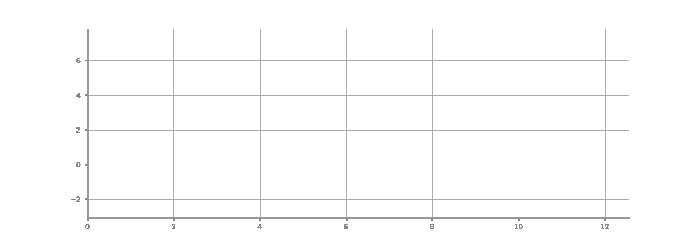

<p align="center">
  
</p>

<h1 align="center">
  
</h1>

<p align="center">
  <a href="README.md"><strong>English</strong></a> ·
  <a href="README.zh-CN.md"><strong>简体中文</strong></a>
</p>

## News

**2026-08-07 — AION 从厚重的固定流程转向自适应执行，并极致压缩初始上下文。**

**AION** 是一个时间序列 harness — 一个将任务规格、运行时执行与结果评估连接成一个稳定流程的显式控制层，面向下一代时间序列工作负载。

时间序列研究正在超越固定预测 benchmark，转向结合预测、上下文推理、工具使用和结构化决策支持的任务。AION 将这些任务形式化为*任务文件、工作空间与验证接口*的三元组，通过多 agent 调度与分层审查门禁来组织系统。

<p align="center">
  <a href="#-快速开始"></a>
  <a href="#-组件"></a>
  <a href="LICENSE"></a>
  <a href="https://arxiv.org/abs/2605.25045"></a>
</p>

<p align="center">
  
  
  
  
  
  
  
  
  
  <a href="https://github.com/ztxtech/aion"></a>
  
  <a href="https://deepwiki.com/ztxtech/aion"></a>
</p>

---

## ✨ AION 是什么？

现有的 benchmark 和 agent 系统各自只捕捉了向下一代时间序列任务转变的一部分：benchmark 通常过早简化任务，而单纯的 agent 不提供时间约束、证据纪律或可靠的停止标准。

AION 作为基于 [OpenCode](https://github.com/anomalyco/opencode) 的**时间序列 harness** 来填补这一空白。它通过专业化 agent — 需求分析、证据收集、实现、分层审查 — 来组织工作，并通过协议管理调度、回传、rebuttal 和停止/继续决策。

---

## ⏱️ 为什么是时间序列专用 harness？

通用 harness 在时间序列任务上经常失效，因为它们并没有为这种场景设计。AION 端到端地做了时序特化，避免以下痛点渗透到最终答案：

- **隐藏的时间泄露。** 来自未来窗口的 timestamp、跨 horizon 取值、label 泄露。AION 通过 **时间性奠基** —— 显式窗口契约与时间敏感的校验 —— 让预测结果严格尊重给定 horizon。
- **方法论感知不足。** 在尚未了解 benchmark、regime、样本量时就选定了模型。AION 通过 **知识引导的搜索**，让证据收集围绕真实的时间序列方法族、baseline 和 SOTA，而不是通用的网页结果。
- **停止不可靠。** 第一个看起来合理的答案就停，或者跑满固定轮数就停。AION 通过 **分层可靠性检查** —— critic 门禁和 pre-stop review —— 执行真正的停止纪律。
- **证据开放但结论不可信。** 自由形式的证据漂移到无支撑的断言。AION 保持证据绑定式输出，让每条结论都能追溯到磁盘上的真实来源。

这些机制共同保证 AION 在开放的时序证据下工作，同时维护输出的合法性和停止纪律。

---

## 🏗️ 架构

AION 是 OpenCode V2 的编译型 TypeScript 插件。仓库保存源码和发布工具；`aion-ts init` 会把自包含的 server 与 TUI bundle 安装到项目里。专业化 agent、原生 skill、运行时协议、记忆文件和评测契约都通过插件加载。

### 目录结构

```
aion/
├── src/
│   ├── index.ts              # 插件定义与 V2 hooks
│   ├── create-managers.ts    # 治理、trace 与阶段状态
│   ├── create-tools.ts       # AION 工具注册表
│   ├── create-hooks.ts       # OpenCode 生命周期 hooks
│   ├── workspace-bootstrap.ts # 运行时工作区初始化
│   ├── agents/               # 8 个专业 agent 工厂
│   ├── tools/                # 20 个运行时工具
│   ├── prompts/              # 治理、协议和 agent prompt
│   ├── scheduling/           # 自适应派单与无进展处理
│   ├── shared/               # 计划图、日志、toast 与工具函数
│   └── tui/index.tsx         # 原生 V2 AION 看板
├── bin/aion-init.js          # aion-ts 安装器
├── scripts/                  # 构建、安装与发布工具
├── test/                     # 单元、CLI 与集成测试
└── .opencode/
    ├── skills/               # 17 个 OpenCode 原生 skill
    └── themes/aion.json      # AION TUI 主题
```

在项目里执行 `aion-ts init .` 后，OpenCode 会直接发现 `.opencode/plugins/aion/server.js` 和 `tui.js`。运行时会在 `.opencode/memory/` 和 `.opencode/trace.md` 创建记忆与追踪文件。

---

## 🚀 快速开始

### 0. 环境前提

AION 需要标准的 Linux/macOS 环境，并确保以下系统命令可用：

| 命令            | 用途                                 | 备注        |
| --------------- | ------------------------------------ | ----------- |
| `node`          | 运行 aion-ts 安装器                  | 建议 ≥ 18  |
| `git`           | 本地 checkpoint 历史                 | 通常已预装  |
| `curl`          | 下载 AION、网页搜索回退              | 通常已预装  |
| `tar`           | 解压发布归档                         | 通常已预装  |
| `python3`       | Python 工具链、校验器                | 建议 ≥ 3.10 |
| `bash`          | cli.sh 与技能脚本                    | ≥ 4.0       |

部分命令（如通过包管理器安装 `git` 或 `curl`）可能需要 **root/sudo** 权限。在最小化容器或 CI 镜像中，请先安装这些依赖：

```bash
# Debian / Ubuntu
sudo apt-get update && sudo apt-get install -y git curl tar python3

# RHEL / CentOS / Fedora
sudo dnf install -y git curl tar python3

# macOS（通常已预装；如未安装）
brew install git curl python3
```

### 1. 安装 OpenCode

```bash
# 一键安装（YOLO，V2）
curl -fsSL https://opencode.ai/v2/install | bash

# 包管理器安装
npm install -g @opencode/cli       # 或 bun/pnpm/yarn
brew install anomalyco/tap/opencode-v2 # macOS 和 Linux
paru -S opencode-beta              # Arch Linux（AUR）
```

### 2. 配置 OpenCode

```bash
opencode    # 启动 TUI，然后按提示选择 provider 并认证
```

支持 **Claude / OpenAI / Codex / Copilot / Gemini** 及任何兼容端点。

### 3. 安装 AION CLI

```bash
curl -fsSL https://raw.githubusercontent.com/ztxtech/aion/master/scripts/install.sh | bash
```

如果 `~/.local/bin` 不在 `PATH` 中，先把它加入 shell profile：

```bash
export PATH="$HOME/.local/bin:$PATH"
```

### 4. 将 AION 添加到你的项目

```bash
cd your-project
aion-ts init .
```

安装器只写入目标项目，不会修改全局 OpenCode 配置。

### 5. 运行

```bash
# 交互式 TUI 模式
opencode

# 非交互式 run 模式
opencode run --agent aion "你的任务描述"

# 指定模型
opencode run --agent aion -m anthropic/claude-sonnet-4 "分析这个时间序列数据集"
```

### 6. Goal 模式（可选）

AION 会在项目级 `opencode.json` 里配置 [`@prevalentware/opencode-goal-plugin`](https://github.com/prevalentWare/opencode-goal-plugin)。插件提供 `/goal` 斜杠命令、持久化目标状态、空闲自动续跑和 goal 侧边栏指示器。

```
# 在 TUI 里启动一个 goal，让 AION 迭代 task.md
/goal 用 AION harness 完成 task.md 定义的任务
```

Agent 启动时检查 `get_goal`。有活动 goal 时，它会选最高价值的剩余动作、派发对应 subagent、更新记忆文件，然后自动续跑直到所有 critic 门通过并用证据关闭 goal。

### `run` / `tui` 与执行策略的关系

OpenCode 的 `run` 和 `tui` 描述的是界面形态，不等于 agent 是否应该频繁向用户提问。

- `run`
  这是非交互执行界面。对本模板而言，`run` 默认搭配 `autonomous`：agent 应先做本地探测，自己选择默认最优路径，并持续推进，而不是停下来询问常规环境或流程选择。
- `tui`
  这是交互式终端界面。对本模板而言，`tui` 可以搭配 `autonomous`，也可以在用户明确希望参与关键分叉时搭配 `interactive`。
- `tui + autonomous`
  用户在场、可以观察会话，但 agent 对常规默认动作仍应自己决策。处于 TUI 中，不代表 agent 应该把低风险默认项都抛回给用户。
- `tui + interactive`
  只在用户明确希望共同决策关键分叉时使用。即便如此，agent 也必须先做本地探测，只有在多个同样合理且会实质影响后续路径的候选方案仍然并存时，才向用户发起简洁确认。
- `run + interactive`
  本模板不把它视为默认支持组合。`run` 的目标是连续自动执行；如果流程需要在关键节点停下来等待用户选择，`tui` 更合适。

对 Python 环境，本模板的默认决策树是：

- 先判断任务是否真的需要 Python
- 若工作区根目录已存在 `.venv`，优先复用
- 否则服从更强的项目环境约束，例如 `pyproject.toml`、`.python-version`、`environment.yml`、`requirements*.txt`、`uv.lock`
- 若仍无更强约束，再创建工作区根目录 `.venv`

在 `autonomous` 下，只要这条决策树没有出现真实冲突，就直接按默认优先级执行，不先问用户解释器偏好。在 `interactive` 下，也必须先做同样的本地探测；只有当探测后仍存在多个同样合理、且会显著影响依赖或实现路径的候选环境时，才向用户发起一次简洁确认。

### 7. CLI 运行模式（进阶）

使用 `cli.sh` 进行自动化、自动续跑的实验运行：

```bash
# 基本运行
bash cli.sh

# 指定模型
bash cli.sh -m anthropic/claude-sonnet-4

# 开启 debug 日志
bash cli.sh --debug

# TUI 模式
bash cli.sh --mode tui

# 限制自动续跑轮数
bash cli.sh --max-continues 10
```

### 自动 / 交互场景下怎么写 Prompt

OpenCode 的原生主 agent 是 `aion`。它由本地插件注册，负责把工作派发给边界明确的专业 agent。

如果自己写提示词而不是使用默认 `cli.sh` prompt，应明确执行策略，并指定 `aion` agent。

- 对非交互、自动执行，先读取根目录任务文件和 `.opencode` 合约，并注明模式：

```text
请先读取根目录任务文件和 `.opencode` 合约。请按 `run + autonomous` 模式执行：常规流程不需要询问我，只有配置好的 critic 门禁批准后才停止。
```

- 对交互式 TUI 协作，明确说明你只想参与真实分叉：

```text
请先读取根目录任务文件和 `.opencode` 合约。请按 `tui + interactive` 模式执行：常规动作自行决定，只有重要分叉才询问我。
```

- 如果你想在 TUI 里看过程，但不希望它频繁问你，也可以直接写：

```text
请先读取根目录任务文件和 `.opencode` 合约。请按 `tui + autonomous` 模式执行：我希望观察过程，但不希望被常规流程打断。
```

对 Python 环境，一个更好的交互式提示词写法是要求 agent 先探测、后上交分叉，例如：

```text
如果任务需要 Python，请先检查工作区是否已有可用 .venv 或更强项目约束。只有当仍存在多个同样合理、且会显著影响依赖或实现路径的环境选择时，再来问我。
```

---

## 📦 示例

[`example/`](example/) 目录包含可直接运行的工作空间，用于在具体时序任务上演示 AION 的端到端能力。

> **⚠️ 临床免责声明 — `example/aion-medical-demo/` 仅为演示案例。** [`example/aion-medical-demo/`](example/aion-medical-demo/) 是 AION 在医疗风格问题上的一次自包含演示，外层 wrapper 仅为录制 AION 演示视频而存在。心电图数据虽来自真实的 PhysioNet PTB 数据库，但样本量极小（仅 3 名患者）；ICU 生命体征数据为合成数据。Agent 生成的模型、指标和报告仅供演示 —— **未经验证，不可用于任何临床决策**。详见 [`example/aion-medical-demo/README.md`](example/aion-medical-demo/README.md) 完整免责声明与录制说明。

### 医疗时序案例 — 心电图诊断与 ICU 败血症预测（演示）

[`example/aion-medical-demo/`](example/aion-medical-demo/) 在临床案例外层包裹了录制专用脚手架。目标是让 AION 的全部特性在一次运行中触发，专为 YouTube 视频 *"AION: A Time-Series AI Harness (Full Clinical Demo)"* 录制。

```bash
cd example/aion-medical-demo/medical
opencode
> introduce yourself by completing this task, AION
```

详见 [`example/aion-medical-demo/README.md`](example/aion-medical-demo/README.md) 获取 wrapper 用途、22 特性触发地图，以及"真实 AION 项目并不需要触发全部特性"的设计说明。

### 本地 Kaggle 风格预测竞赛

[`example/kaggle/`](example/kaggle/) 是 Kaggle **Store Sales - Time Series Forecasting** 比赛（Corporación Favorita）的本地复刻版本，为离线快速迭代而改造。轻量级的本地评估服务器模拟 Kaggle 的提交和评分 API —— agent 通过相同的 HTTP 接口下载数据、训练模型并提交预测，但可获得即时反馈且没有每日提交上限。详见 [`example/kaggle/README.md`](example/kaggle/README.md)。

---

## 🤝 Agent 角色

| Agent | 职责 |
|-------|------|
| **aion** | 主控 — 调度子 agent、执行审查门禁、驱动收口 |
| **requirements-analyst** | 读取任务与工作区材料，抽取目标、输入与约束 |
| **information-collector** | 补齐 SOTA、顶会顶刊、官方实现与领域知识 |
| **search-scout** | 单轴检索助手，用于聚焦式证据收集 |
| **coder** | 实现、实验、交付与可视化 |
| **experiment-runner** | 执行固定实验包并保留完整 artifacts |
| **ts-critic** | 时间序列方法审查 + Pareto 继续/停止治理 — `c-critic` 之前的最高治理门 |
| **c-critic** | 最终最小上下文冷启动批判 — 系统最高治理权 |

### 治理顺序

在 blocker 判定、rebuttal 结论、路线回退、stop-go、completion-gate 与最终交付判定上：

```
c-critic > ts-critic > 主 agent > 其他子 agent
```

主 agent 负责**调度与执行组织**，但**不**拥有高于 critic 的关门权。

进一步地，这里的角色边界默认采用“能力互斥优先委派”而不是“主 agent 全都自己做一遍”：系统性需求重构优先交给 `requirements-analyst`，系统性外部检索与证据链建设优先交给 `information-collector`，真实代码 / 脚本 / 实验实现优先交给 `coder`，治理性批判与 stop-go 优先交给 `ts-critic` / `c-critic`。主 agent 只保留最小必要的路由级核对、集成性修改和无法安全拆分的极小动作。

---

## 📦 组件

每个组件只承担一个明确职责，并遵循 OpenCode 的原生发现规则：

| 组件 | 路径 | 职责 |
|------|------|------|
| **插件定义** | `src/index.ts` | 注册 V2 hooks、工具、agent、权限和看板状态 |
| **专业 agent** | `src/agents/` | 需求分析、证据收集、编码、聚焦检索、实验与审查 |
| **原生 skill** | `.opencode/skills/<name>/SKILL.md` | 由 OpenCode `skill` 工具按需发现和加载的能力 |
| **运行时协议** | `src/prompts/` | 调度、回传、rebuttal、压缩、记忆同步与停止/继续规则 |
| **记忆与 trace** | `.opencode/memory/`、`.opencode/trace.md` | 单次运行证据、快照、决策与可复用发现 |
| **原生看板** | `.opencode/plugins/aion/tui.js` | V2 session panel 中的计划 DAG、调用图、阶段与 toast |
| **CLI 入口** | `bin/aion-init.js` | 把自包含插件安装到目标项目 |

### 任务分级

主 agent 在调度前对每个任务进行分类：

| 级别 | 信号 | 流程 | 上下文 |
|------|------|------|--------|
| **L0** 简单 | 单文件编辑、格式修复、简单查询 | 直接执行 | 最小 |
| **L1** 轻量 | 明确任务、无需外部搜索 | 主 agent + ≤1 个专家 | 小 |
| **L2** 标准 | 多步骤、需要搜索/实验 | RA → IC → coder + critic 门禁 | 标准 |
| **L3** 完整 | 基准测试、正式报告、多分支 | 完整链 + 预停止门 | 完整 |

### 模型自适应执行

驱动模型可以选择更轻或更重的路径：强模型可以跳过不必要的计划深度，弱模型保留更完整的计划和 critic 覆盖；治理顺序和最终评审门禁不会被移除。

---

## 📋 协议清单（8 个）

协议约束执行 — 管理 agent 如何通信、升级和压缩上下文：

| 协议               | 用途                                                                         |
| ------------------ | ---------------------------------------------------------------------------- |
| **dispatch**       | 子 agent 派单，支持 `full_context` / `compacted_context` / `minimal_context` |
| **reportback**     | 结构化回传，含自我批判                                                       |
| **rebuttal**       | 路线挑战协议                                                                 |
| **stop-go**        | 停止/继续治理，含 critic 冲突解决                                            |
| **lifecycle**      | Agent 生命周期管理                                                           |
| **memory-sync**    | 跨 agent 记忆同步                                                            |
| **runtime-events** | 运行时事件追踪与 trace 更新                                                  |
| **compaction**     | 长期多 agent 会话的上下文压缩                                                |

---

## 🧠 记忆与 Trace

AION 维护两套互补的追踪系统：

- **`.opencode/trace.md`** — 单次任务执行 trace：关键决策、失败复盘和交付检查点
- **`.opencode/memory/`** — 跨任务持久记忆：正面/负面发现、agent 关系、决策、特征
- **`.opencode/memory/context-snapshot.md`** — 规范化压缩 artifact，由 `initial-prompt`、`progress`、`decisions`、`todo-map` 和活跃 blocker 提炼而成
- **本地 git** — 宿主项目根目录的细节级检查点历史（自动初始化，从不推送）

记忆和 git 各有分工：记忆负责抽象经验和判断，git 负责细节级变更历史和关键节点回放。

---

## 📡 CLI 参考

### `aion-ts` — 插件安装器

`aion-ts` 是主要的项目安装入口：

```bash
aion-ts init [target-dir] [--force]
```

| 参数 | 默认值 | 描述 |
| ---- | ------ | ---- |
| `target-dir` | `.` | 要初始化的项目目录 |
| `--force`, `-f` | 关闭 | 覆盖已安装的 AION bundle |
| `--help`, `-h` | — | 显示帮助 |

### `cli.sh` — OpenCode 启动器（旧版）

`cli.sh` 仍是可选的便捷入口，用于 OpenCode 的 run 或 TUI 执行，并支持可选的自动续跑：

```bash
bash cli.sh [OPTIONS]
```

### 选项

| 参数                  | 默认值       | 描述                                            |
| --------------------- | ------------ | ----------------------------------------------- |
| `--mode MODE`         | `run`        | 启动模式：`run` 或 `tui`                        |
| `-m, --model MODEL`   | （来自配置） | OpenCode 模型（如 `anthropic/claude-sonnet-4`） |
| `--max-continues N`   | `30`         | 最大自动续跑轮数；`0` 表示不限                  |
| `--continue-delay S`  | `2`          | 每次自动续跑间隔（秒）                          |
| `--bash-timeout-ms N` | `1200000`    | OpenCode bash 默认超时（毫秒）                  |
| `--no-auto-continue`  | （关闭）     | 禁用自动续跑                                    |
| `--debug`             | （关闭）     | 开启详细 debug 日志                             |
| `--export`            | （关闭）     | 运行结束后导出 session JSON                     |
| `-h, --help`          | —            | 显示帮助                                        |

### 示例

```bash
# 基本自主运行
bash cli.sh

# 指定模型与限制轮数
bash cli.sh -m openai/gpt-4.1 --max-continues 5

# Debug 模式并导出 session
bash cli.sh --debug --export

# 交互式 TUI
bash cli.sh --mode tui --no-auto-continue
```

---

## 🛡️ 核心约束

Harness 在整个系统中强制执行硬性边界：

- **禁止知识/数据泄露** — 未来信息、标签、隐藏集内容和私有数据绝不能泄露到特征、代码、日志或输出中
- **彻底的怀疑主义** — 单次成功或指标提升不是可靠的证据；必须主动排查泄露、伪相关、过拟合和未验证假设
- **治理层级** — 所有治理决策中 `c-critic > ts-critic > 主 agent > 其他`；主 agent 不能覆盖 critic blocker
- **能力互斥优先委派** — 只要现有角色已覆盖某类工作，主 agent 默认就应委派而不是自己亲做；若暂不并行或暂不委派，必须有明确且范围很小的理由
- **Benchmark-first** — 有排行榜或竞赛的任务必须维护并行分支：自主探索 + 高分方案逆向吸收
- **仅 Mermaid 图表** — 所有结构图必须使用 Mermaid；正式输出中禁止 ASCII/纯文字示意图
- **工作区清理** — 最终交付前必须清理空目录、临时文件和调试残留

---

## 🌍 生态

AION 是时间序列 harness 研究生态的一部分：

- 基于 [OpenCode](https://github.com/anomalyco/opencode) — 开源 AI 编码 agent

---

## 📝 引用

如果你在研究中使用 AION，请引用：

```bibtex
@misc{zhan2026aion,
      title={AION: Next-Generation Tasks and Practical Harness for Time Series},
      author={Tianxiang Zhan and Xiaobao Song and Tong Guan and Shirui Pan and Ming Jin},
      year={2026},
      eprint={2605.25045},
      archivePrefix={arXiv},
      url={https://arxiv.org/abs/2605.25045},
}
```

---

## 🤝 参与贡献

AION 是社区驱动的研究项目。我们欢迎以下方面的贡献：

| 领域      | 示例                                       |
| --------- | ------------------------------------------ |
| **Agent** | 新的专门化 agent 角色                      |
| **技能**  | 领域知识 `.md` 文件（金融、气候、医疗...） |
| **协议**  | 新的协调或治理模式                         |
| **规则**  | 领域特定约束集                             |
| **评测**  | Suite 定义、grader、scorecard              |
| **模板**  | 记忆模板、工作区脚手架                     |

---

## 📄 许可证

MIT — 详见 [LICENSE](LICENSE)。

---

<p align="center">
  <strong>AION</strong><br>
  <em>Next Generation Tasks and Practical Harness for Time Series</em>
</p>

<div align="center">
  <a href="https://star-history.com/#ztxtech/aion&Date">
    <picture>
      <source media="(prefers-color-scheme: dark)" srcset="https://api.star-history.com/svg?repos=ztxtech/aion&type=Date&theme=dark" />
      <source media="(prefers-color-scheme: light)" srcset="https://api.star-history.com/svg?repos=ztxtech/aion&type=Date" />
      
    </picture>
  </a>
</div>

<p align="center">
  <em>感谢访问 AION!</em><br>
  
</p>
